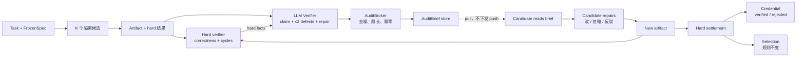

<!-- markdownlint-disable MD013 -->

# SAT 审计迁移：实验方案与结果

> 配套 HTML 版：[sat-gp-audit-experiment-brief.html](sat-gp-audit-experiment-brief.html)
>
> EdgeBench VLIW · 官方 Judge · N0 / N0v / N1 / N2 / N3
>
> 设计目标 T=2h · K=4 · C=1 · R=3；当前最新数据为 R=1
>
> 2026-10-29：N2/N3 最新重跑；N0/N0v/N1 为 10-27 参考批次

## 一、实验目标

本实验不试图复现 SAT 的固定团队或 peer 协作收益。它只回答一个更窄、可归因的问题：

> 在 Goal-Plus 的隔离候选拓扑中，“独立审计 + 有界诊断 + 候选修复”这条回路，能否在 VLIW 任务上提高答案质量，并且增量可以拆到生产、投递和闭环三个环节。

### 1.1 三个目标

| 目标 | 要回答的问题 |
| --- | --- |
| 效果 | 在 EdgeBench VLIW 官方 Judge 下，审计回路是否改善 official score、cycles 和 correctness，而不只是“有没有发出 brief” |
| 归因 | 把“多一次 verifier 调用”“审计是否送达”“候选是否真的修复”拆开，分别估计生产、投递、闭环的增量 |
| 边界 | 验证方案没有靠 peer 通道、没有让 verifier 改写 artifact、没有绕开 hard Evidence 或 Selection 来制造提升 |

### 1.2 研究问题与主对照

| 研究问题 | 主对照 | 主要看什么 | 不能回答什么 |
| --- | --- | --- | --- |
| RQ1 审计生产 | N1 − N0v | audit precision、auditable rate、缺陷类型、briefs per record | 不能说明投递有效；N1 只生产不投递 |
| RQ2 投递 | N2 − N1 | official score、delivery rate、uptake、repair lift | 不能说明闭环有效；N2 没有回执 |
| RQ3 闭环 | N3 − N2 | verified rate、repair lift、harm、time-to-repair | 不能说明 SAT 团队协作整体有效 |
| RQ4 成本与边界 | N0v − N0（可选）；N2/N3 成本 | tokens、cost、verifier calls、latency、隔离与 hard Evidence 约束 | 不能把“多调用一次模型”的成本差当成审计效果 |

### 1.3 成功标准

- **硬门槛：** correctness 不出现系统性回退；official Judge 结果可复算；hidden case 只在最终判定使用。
- **主效应：** N2−N1 或 N3−N2 的 official score 按赛事方向改善，且配对 95% CI 支持；否则报告负结果，不更换主终点。
- **机制证据：** 审计有产出、brief 可送达、候选有回执、artifact 有变化；任何一步缺失，都不能跳到“分数提升”。
- **成本可接受：** token、verifier 调用和延迟增量在预算内；否则即使分数提升，也要报告代价。
- **可归因：** 每个对比只改变一个环节；Pi 与 Codex 分开汇总，不合并成一个大样本。

> **先机制，后分数：** 如果 delivery 或 uptake 没有发生，分数差异不能解释为“审计有效”。如果机制成立但分数无变化，结论是“审计没有转化为更好的答案”，而不是“实验失败”。

## 二、新方案架构与 SAT 对应关系

方案只保留 SAT 的“审计—修复”回路，不复制固定角色和 peer 通信。四条所有权边界是：

1. **Verifier 审计**
2. **Steering 投递**
3. **Candidate 修复**
4. **Hard verifier / Selection 裁判**

### 2.1 架构图



读法：从左到右是阶段推进；`New artifact → Hard verifier` 是闭环；brief 不改变 settlement、selection 或 promotion。

### 2.2 所有权边界

| 角色 | 负责 | 不负责 |
| --- | --- | --- |
| LLM Verifier | 独立审计、定位 evidence gap | 不直接改 artifact |
| Steering / pull | 在候选下一次工具调用时送达 brief | 不修复、不 push、不等待 |
| Candidate | 在自己的 edit surface 内修复/忽略/反驳 | 不能改 acceptance、Judge 或 peer artifact |
| Hard verifier + Selection | hard 结果、最终选择 | 不被 brief 改写 |

### 2.3 为什么这样设计

- **不让 verifier 直接修：** verifier 没有候选的 edit surface；直接改 artifact 会把审计和修复混在一起，也会污染 hard Evidence。
- **用 pull 而不是 push：** verifier 是异步的，候选可能在审计产出前已经结束 turn；持久化 + 拉取把时间解耦，不新增 host wait loop。
- **送达还不够：** 工具返回 brief 不等于候选读了，读了不等于改了，改了不等于分数更好；N3 增加回执，并用后续 hard settlement 生成 credential。

### 2.4 SAT 机制到 Goal-Plus 的对应

| SAT 机制 | Goal-Plus 对应 | 处理 | 保留 / 替换的理由 |
| --- | --- | --- | --- |
| explorer / candidate pool | 相互隔离的 parallel candidates | 替换 | 保留多候选探索，但不打开 peer 通道，也不共享草稿 |
| critic / peer audit | LLM Verifier 的 VerifierAudit + VLIW hard facts | 替换 | 审计需要独立性；用 verifier 替代固定 critic |
| repair action | AuditBrief.repair + 候选下一次尝试 | 保留 | 把“下一步查什么”变成有界动作，执行者仍是候选 |
| peer discussion | 单向 brief + 按需 pull | 替换 | 只传递审计结论，不允许候选互相对话 |
| integrator | 现有 Selection / Promotion | 保留但不改 | 整合仍由 hard/quality 规则完成 |
| strategy bank / reflection | 冻结的 task reference + defect taxonomy | 部分保留 | 本轮不做跨 run 学习，先验证审计信号 |
| fixed team / team phases | 不迁移 | 舍弃 | Goal-Plus 没有固定团队；强行加入角色会违反候选隔离 |
| coverage vs selection gap | coverage + selection loss + audit precision | 保留为观测 | “有更好的候选”不等于“最终选中” |

> **与 SAT 的边界：** 本实验不声称复现 SAT 的团队收益，也不使用固定角色或 peer 通信。它检验的是：在 Goal-Plus 的隔离候选拓扑中，审计—修复信号是否有增量价值。

## 三、实验分组条件

所有组固定同一 VLIW 任务、官方 Judge、模型、T/K/C/R 和 evaluator 合同，只改变 verifier / audit / closure。N0 是可选的“无 verifier”基线；主归因只用 N0v/N1/N2/N3。

### 3.1 分组

| 组 | LLM Verifier | 审计产出 | 投递 | 回执 / credential | 相对上一组只增加 | 用途 |
| --- | --- | --- | --- | --- | --- | --- |
| N0 `optional` | off | off | off | off | 无 verifier 基线 | 只回答多一次 verifier 调用的算力影响 |
| N0v `control` | on；diagnostic scores | off | off | off | verifier 调用 | compute-matched 控制：有 verifier，无 brief |
| N1 `shadow` | on | shadow | 不投递 | off | 审计生产 | H1：审计能否产出可定位缺陷 |
| N2 `pull` | on | apply | pull | off | 投递 | H2：送达是否改变行为并改善答案 |
| N3 `closure` | on | apply | pull | response + credential | 闭环 | H3：回执与 hard credential 是否进一步提高修复 |

### 3.2 归因台阶

| 台阶 | 对比 | 含义 |
| --- | --- | --- |
| Production | N1 − N0v | 只多“审计生产”。如果没有可定位缺陷，后面不需要谈投递 |
| Delivery | N2 − N1 | 只多“送达”。如果 delivery/uptake 没有发生，分数差异不能归因于审计 |
| Closure | N3 − N2 | 只多“回执 + credential”。检查“送达不等于修复”的最后一公里 |
| Overall | N2 − N0v | 审计 + 投递的总效果；不能反过来拆成生产或投递各自贡献 |

### 3.3 固定条件

| 维度 | Phase 0 | Phase 1 |
| --- | --- | --- |
| Benchmark | local-vliw | EdgeBench VLIW 官方 Judge |
| 预算 T | 1800s | 7200s（2h） |
| 候选 / 并发 / 重复 | K=4；C=1；R=3 | K=4；C=1；R=3 |
| Harness / 模型 | 同一变体内固定 | Pi 与 Codex 分开，不合并 |
| Judge | 本地 evaluator | 官方 Judge；hidden 只做最终判定 |
| 审计合同 | 冻结 task reference、verifier instruction、defect taxonomy | 同左；实验中途不改 |
| 候选拓扑 | 隔离候选；无 peer；无旧 SAT 角色/阶段 | 同左 |
| 投递 | 旧 steering push 关闭；审计 brief 走 pull | 同左 |
| Selection | 保持既有 hard/quality 规则 | 同左；审计不得改写 |

> **统一约束：** 全部 N 组使用隔离候选、`allocation=None`、旧 steering 推送关闭；审计 brief 只走 pull。不启用旧 SAT 角色/阶段；同一变体内 K=4、C=1、R=3、同 T。禁止把 Pi 与 Codex 混成一个样本，禁止跨 T 比较，禁止在看到结果后更换主终点。

## 四、实验步骤

先接线，再小预算，再正式矩阵。每一步都有明确产物和门禁；Gate 不通过时先修机制，不扩预算。

### 4.1 步骤

1. **冻结合同**
   - 固定 task、Judge、harness/模型、T/K/C/R、verifier audit 合同、task reference hash、audit mode 和 closure。
   - 产物：freeze manifest、task reference hash、profile、source commit。

2. **接线 smoke**
   - 确认 N1 有 brief 产出但不投递；N2 的 brief 能在候选下一次工具调用时取到；N3 的 response 工具可调用。
   - 确认没有 push steering、旧 SAT 角色或 peer 通道。
   - 产物：brief 样本、delivery 记录、response 记录、环境检查。

3. **Phase 0：短预算 pilot**
   - local-vliw，N0v/N1/N2，T=1800s，R=3，共 9 个 campaign。
   - 只回答接线、审计精度、delivery、方差和 N0v 是否有 headroom。
   - 产物：audit 摘要、precision 标签、delivery rate、方差估计。

4. **过 Gate 0 / Gate 1**
   - Gate 0 看接线；Gate 1 看审计质量、delivery 和 harm。
   - 失败时修 producer/brief/投递，不进入 2h 正式矩阵。
   - 产物：gate 记录、失败原因、修复记录。

5. **Phase 1：正式矩阵**
   - EdgeBench VLIW，N0v/N1/N2/N3，T=7200s，R=3；Pi 与 Codex 分开运行。
   - 按两套 harness 计，共 24 个 campaign；保留官方 Judge 结果和机制计数。
   - 产物：official score、cycles、briefs、credentials、token/cost。

6. **导出与分析**
   - 导出 brief/credential，汇总 delivery、uptake、repair lift 和 paired effect。
   - 用 bootstrap 95% CI 与 MDE 判断方向，不只报均值。
   - 产物：结果表、配对分析、负结果解释、复现记录。

### 4.2 运行矩阵

| 阶段 | Arms | Harness | R | Campaign 数 | 回答 |
| --- | --- | --- | --- | --- | --- |
| Phase 0 | N0v / N1 / N2 | 1 套（local） | 3 | 9 | 接线、审计精度、delivery、方差 |
| Phase 1 | N0v / N1 / N2 / N3 | Pi、Codex 分开 | 3 | 24 | 投递与闭环的因果增量 |
| Phase 2 `optional` | N3 + final audit | 按需 | 按需 | — | 收尾审计、tie-break、二次裁决 |

### 4.3 门禁

| Gate | 检查 | 失败处理 |
| --- | --- | --- |
| Gate 0 接线 | N1 有 brief 产出但不投递；N2 的 brief 可送达；N3 的 response 可调用；没有 push steering、SAT 角色或 peer 调用 | 只做本地 smoke，不跑正式矩阵 |
| Gate 1 审计质量 | audit precision 与覆盖率过冻结阈值；delivery 可解释；N0v 有 headroom；harm 未系统性恶化 | 修 producer/brief/投递，不扩预算 |
| Gate 2 效果 | N2−N1 或 N3−N2 的 official score 按赛事方向改善且 CI 支持；机制计数与分数变化一致；成本可接受 | 通过 → 结论；不通过 → 报告负结果与机制解释 |

> **执行原则：** Phase 0 不通过，不进入 Phase 1；Phase 1 不显著，不改主终点。先检查 delivery/uptake 是否真的发生，再检查审计是否被采纳。

## 五、测量指标

指标分四层：硬终点、审计机制、行为变化、成本。每类都必须能从持久化 artifact 复算，而不是从 transcript 猜测。主终点是 EdgeBench VLIW 官方分数；correctness gate 是硬门槛，cycles 作为 VLIW 关键指标同时报告。

| 层级 | 指标 | 方向 | 定义 / 来源 | 用途 |
| --- | --- | --- | --- | --- |
| 硬终点 | official score | 按赛事定义 | EdgeBench 官方 Judge；final only | H2/H3 主终点 |
| 硬终点 | correctness gate | 越高越好；不得回退 | hard verifier / 官方 Judge | 硬门槛 |
| 硬终点 | cycles（max / best / slowest） | 越低越好 | VLIW evaluator；同时报最大、最好、最慢 case | VLIW 主指标 |
| 审计生产 | briefs、auditable rate、defect count | — | `audit/briefs` | H1 |
| 审计质量 | precision by kind、coverage | 越高越好 | 独立标签 + defect taxonomy | H1 |
| 投递 | delivered、delivery rate | 越高越好 | brief status + tool response；delivery rate = delivered / produced | H2 |
| 行为 | accepted / ignored / rebutted、artifact change | — | 候选回执 + diff | H2 |
| 修复 | uptake、repair lift、harm、time-to-repair | lift 越高越好；harm 越低越好 | brief 前后 hard settlement；只在 artifact 变化时计算 | H2/H3 |
| 闭环 | queued / verified / rejected | verified 越高越好 | `audit/credentials` + 后续 hard score/artifact | H3 |
| 选择 | coverage、selection loss、spread | coverage 越高越好；loss 越低越好 | run 内 candidate best vs selected | 解释“有更好候选但没选中” |
| 成本 | tokens、cost、verifier calls、latency | 越低越好 | verifier usage + campaign manifest | 决策与 harm 解释 |

### 5.1 测量规则

- **VLIW 不能用平均 cycles 掩盖慢 case：** 必须同时报告 max、best 和 slowest case；cycles 越低越好。
- **hidden Judge 只做最终判定：** public feedback 不能替代 hidden 结论；调参不得使用 hidden case。
- **Audit precision 需要独立标签：** 未被标注的 brief 记为 unknown，不记为 correct；不能用候选是否采纳来反推精度。
- **Delivery 不等于 uptake：** 工具返回 brief 只证明送达；accepted 也只证明候选口头接受；artifact change 才证明行为变化。
- **Credential 是 hard-evidence 关闭：** verified 只表示后续 hard score/artifact 改善，不证明具体 defect 的语义被完全修复。
- **配对与不确定性：** 以 task × seed/campaign 为配对单位；报告 paired difference、bootstrap 95% CI 和 MDE；Pi/Codex 分开。
- **缺失数据：** 失败或 incomplete 的 campaign 不进入均值，单独列出原因；不把缺失当 0。

> **解释顺序：** 先看 briefs/delivered/uptake，再看 artifact change/repair lift，最后看 official score。机制不成立时，不解释分数。

## 六、实验结果

### 6.1 当前状态

**2026-10-29 的 N2/N3 重跑是当前主结果；N0/N0v/N1 是 10-27 参考批次，不构成同一个五臂配对矩阵。**

| Arm | batch | campaign | raw cycles | Judge | runtime | budget | eval | verifier records | briefs (prod / deliv) | completion |
| --- | --- | ---: | ---: | ---: | ---: | ---: | ---: | ---: | --- | --- |
| N0 | 10-27 | `edgebench-vliw-audit-n0-codex-r4` | 1298 | 82.60 | 6170s | 85.7% | 20 | 0 | 0 / 0 | pass |
| N0v | 10-27 | `edgebench-vliw-audit-n0v-codex-r4` | 1441 | 75.62 | 4836s | 67.2% | 15 | 7 | 0 / 0 | pass |
| N1 | 10-27 | `edgebench-vliw-audit-n1-codex-r4` | 1354 | 79.78 | 2943s | 40.9% | 9 | 8 | 3 / 0 | pass |
| N2 | 10-29 | `edgebench-vliw-audit-n2-codex-r13` | **1351** | **79.93** | 7721s | 107.2% | 24 | 6 | 3 / 2 | pass |
| N3 | 10-29 | `edgebench-vliw-audit-n3-codex-r12` | 1379 | 78.56 | 5425s | 75.3% | 15 | 10 | 10 / 6 | pass |

- 全部为 `K=4`、`C=1`、`R=1`；`official_edgebench_comparable=false`。
- N2/N3 使用 goal-plus `235e935`、harness `a690808`；N0/N0v/N1 使用较早批次。
- N2 的 7721s 超过 T=7200s，包含 finalization grace；探索 cutoff 仍是 T。
- N0 1298 仍是全表最低 cycles，但它来自 10-27 批次，只能作为参考。

### 6.2 表 R1 · 机制计数

| Arm | Briefs | Delivered | Accepted | Ignored | Rebutted | Pending | Credentials (verified / rejected) | Delivery rate |
| --- | ---: | ---: | ---: | ---: | ---: | ---: | --- | ---: |
| N0 | 0 | 0 | 0 | 0 | 0 | 0 | 0 / 0 | — |
| N0v | 0 | 0 | 0 | 0 | 0 | 0 | 0 / 0 | — |
| N1 shadow | 3 | 0 | 0 | 0 | 0 | 3 | 0 / 0 | 0.0 |
| N2 apply | 3 | 2 | 0 | 0 | 0 | 1 | 0 / 0 | 66.7% |
| N3 closure | 10 | 6 | 1 | 0 | 4 | 4 | 1 / 0 | 60.0% |

- N2 的 closure 关闭，accepted/credential 本来就不适用。
- N2 的 2 条 delivered 中，c001 是 baseline，c004 是 1817 cycles。
- N3 的 6 条 delivered = 1 accepted + 4 rebutted + 1 delivered 未回答；另有 4 条 pending。
- N3 的 1 个 credential 已 verified，0 rejected。

### 6.3 表 R2 · 描述性差值（非配对因果）

| 对比 | n pairs | Mean Δ Judge | Bootstrap 95% CI | MDE | 方向 / 解释 |
| --- | ---: | ---: | --- | ---: | --- |
| N2 − N1 | 1 | +0.15 | — | — | ≈ 持平；N2 1351 vs N1 1354，跨 10-27/10-29 批次 |
| N3 − N2 | 1 | −1.37 | — | — | ↓；N3 比 N2 多 28 cycles，closure 未带来最终收益 |
| N2 − N0v | 1 | +4.30 | — | — | ↑；跨批次，且 N0v 只用了 67.2% 预算 |
| N3 − N0v | 1 | +2.93 | — | — | ↑；跨批次，不是 audit 因果 |
| N0v − N0 | 1 | −6.97 | — | — | ↓；verifier-only 控制，N0v 预算使用更低 |

全部为 R=1；没有重复，因此没有 CI/MDE。`n=1` 只表示一个 task×run，不是统计配对样本。N2/N3 的 28 cycles 差值在单次运行噪声内；不能写成“N3 修复无效”或“N2 更好”的确定结论。

### 6.4 表 R3 · 审计质量与行为

| Arm | audit 记录 (ok/fail) | 完成率 | briefs | delivered | accepted | rebutted | pending | credentials (verified/rejected) | repair lift |
| --- | --- | ---: | ---: | ---: | ---: | ---: | ---: | --- | --- |
| N1 shadow | 6 / 2 | 75.0% | 3 | 0 | 0 | 0 | 3 | 0 / 0 | — |
| N2 apply | 3 / 3 | 50.0% | 3 | 2 | 0 | 0 | 1 | 0 / 0 | — |
| N3 closure | 10 / 0 | 100.0% | 10 | 6 | 1 | 4 | 4 | 1 / 0 | −164 cycles（c004 1543→1379） |
| **合计** | **19 / 5** | **79.2%** | **16** | **8** | **1** | **4** | **8** | **1 / 0** | 仅 N3 c004 可计算 |

- Precision 仍不可计算：没有独立 defect 标签。
- N3 的 4 条 rebuttal 明确表示 frozen process verifier 只暴露 `small_seed_0/1/2` 和 `main_public_seed_123`，无法生成 brief 要求的 per-case evidence。
- 这是 evidence surface / task reference 问题，不是候选无理由拒绝。
- N3 的 1 条 accepted credential 由后续 hard settlement 验证成功。

### 6.5 关键观察

**第一个真实 audit 修复：** N3 c004 的 accepted brief 来自 1543 cycles；候选修复后 hard settlement 为 1379 cycles，credential 状态 verified。这是本次迁移第一次出现：

```text
accepted → artifact change → hard settlement → verified credential
```

−164 cycles。

**但 N3 没有超过 N2：**

```text
N2 c004: 147734 → 1817 → 1482 → 1351
N3 c004: 147734 → 1543 → 1379（repair）→ 1379 retain
```

N3 的修复改善了自己的候选，但 N2 的搜索路径仍然得到更低 cycles（1351 vs 1379）。因此“闭环机制成立”不等于“闭环带来最终收益”。

**N2 的 delivered 线索：** N2 c004 的 brief 在 1817 cycles 时 delivered，之后走到 1482 → 1351。时间顺序符合 audit 影响，但 N2 没有 closure/response/credential，无法区分 brief 与候选自身迭代。

### 6.6 结果判定规则

| 假设 | 支持条件 | 如果不支持 |
| --- | --- | --- |
| H1 审计生产 | N1 相对 N0v 产出可定位缺陷；precision/coverage 过冻结阈值；harm 未系统性恶化 | 修 producer、task reference 或 defect taxonomy；不进入投递归因 |
| H2 投递 | N2−N1 的 official score 按赛事方向改善且 CI 支持；delivery/uptake 与分数方向一致 | 先查 delivery 与 uptake，再查 brief 是否可执行；不更换主终点 |
| H3 闭环 | N3−N2 的 verified rate > 0，repair lift 大于 harm；回执没有诱导过度修复 | 查 credential 关闭条件与回执行为；报告负结果 |

## 七、结论边界与下一步

10-29 的 N3 已经跑出完整闭环，这是第一次可以讨论“修复是否发生”而不是“brief 是否送达”。但单次 R=1 仍然不能回答“审计是否提高最终分数”。

### 7.1 现在可以说的

- N2/N3 两臂 completion pass，K=4；N2 1351 / 79.93，N3 1379 / 78.56，N2 少 28 cycles。
- N3 实现 10/10 audit、6 delivered、1 accepted、4 rebutted、4 pending；1 个 credential 由 hard settlement verified。
- N3 c004 经历 1543 → 1379 的 accepted repair，−164 cycles；完整链路真实发生。
- N2 c004 在无 closure 下走到 1817 → 1482 → 1351；候选自身搜索仍可以优于 N3 的修复结果。
- N3 的 4 条 rebuttal 指出 frozen verifier 只暴露固定 case，无法生成 per-case evidence；这是 evidence surface 问题，不是无理由拒绝。

### 7.2 现在不能说的

- N3 的闭环带来了最终收益：N3 1379 比 N2 1351 多 28 cycles，方向相反。
- audit 提高了 VLIW Judge：R=1，28 cycles 在单次运行噪声内，且 N2/N3 不是同一个五臂批次。
- N2 的 1351 是 delivered brief 的因果收益：N2 没有 closure/response/credential，无法区分 audit 与自身迭代。
- N0 的 1298 是“无 audit 更优”：它来自 10-27 批次，c002 走 6 次迭代，预算/路径不同。
- N3 修复无效：c004 确实被修好并 verified；正确说法是“修复有效，但未超过 N2 的最终候选”。

### 7.3 下一步

1. **修 evidence surface，减少 N3 rebuttal**
   - 4/6 delivered 被 rebutted，原因集中在 frozen verifier 只暴露 `small_seed_0/1/2` 和 `main_public_seed_123`。
   - 要么收窄 brief 的 required evidence，要么提供可调用的 per-case surface。
   - 不要把这类 rebuttal 当成候选不配合。

2. **清掉 N3 的 4 条 pending，再跑 R=3**
   - 同批 N2/N3、同一 harness commit、同一 T/K/C/R，R=3。
   - N0v/N1 也需要同批重跑，才能做配对比较。
   - 当前 28 cycles 差值不能作为结论。

3. **再决定 audit 的去留**
   - 修复机制已经成立（accepted → edit → hard settlement → verified）。
   - 下一步判断它是否稳定改善最终答案，而不是只看单次 c004。

> **决策规则：** 如果 R=3 中 N3−N2 仍为负，但 accepted repair 的比例和 verified rate 稳定，说明闭环改善的是可观测性与局部修复，不是最终选择；如果 N3−N2 转正且 mechanism 一致，才可以说闭环有最终收益；如果 N2−N1 无效，优先修 delivery/uptake，而不是改主终点或扩大预算。

## 参考

- HTML 版：[sat-gp-audit-experiment-brief.html](sat-gp-audit-experiment-brief.html)
- 原始记录：[latest N2/N3 archive](<C:/Users/Forge/Downloads/edgebench-vliw-audit-n2-n3-codex-20261029-114746/edgebench-vliw-audit-n2-n3-codex/report.md>)
- N3 批次：`edgebench-vliw-audit-n3-codex-r12`
- N2 批次：`edgebench-vliw-audit-n2-codex-r13`
