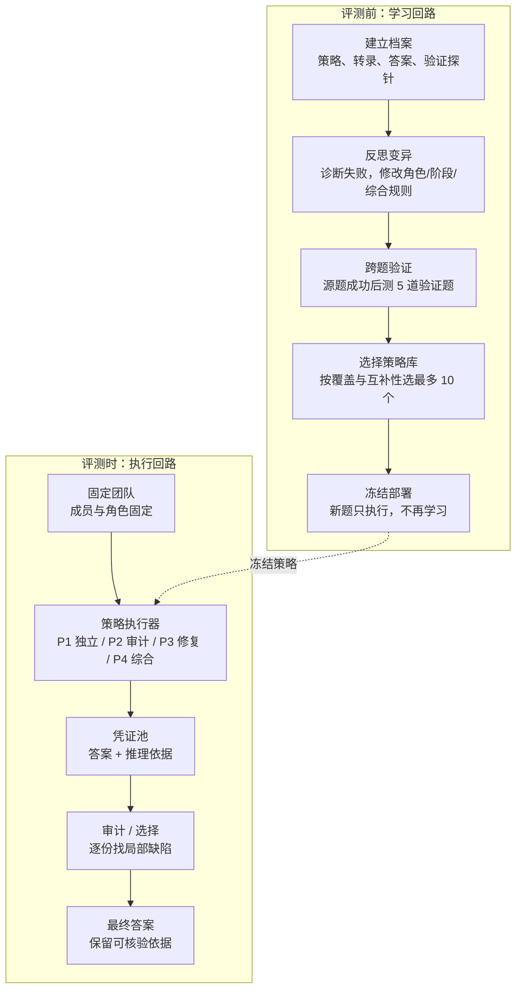
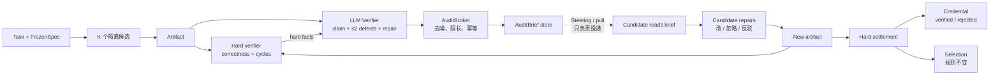

<!-- markdownlint-disable MD013 -->

# SAT → Goal-Plus：论文分析与实验报告

> 配套 HTML 版：[sat-gp-paper-and-experiment-report.html](sat-gp-paper-and-experiment-report.html)
>
> 论文：SAT: Self-Organizing Agent Teams（arXiv:2609.22682v1）
>
> 实验：EdgeBench VLIW · N0/N0v/N1/N2/N3 · Pi/Codex 分开
>
> 状态：结果与结论待统一实验回填

## 一、论文核心思想

SAT 讨论的不是“让更多模型同时回答”，而是：

> 当没有任何一个成员拥有完整解法时，团队能否通过交换部分推理、挑战具体主张、修复错误并重新综合，构造出单个答案中不存在的正确解？

论文把这种能力称为 **collaborative computation**，并把它做成可搜索、可冻结、可迁移的策略资产。

### 1.1 三个可学习对象

策略写成：

```text
P = (S, τ, α)
```

- `S`：阶段列表，例如独立解题 → 具体审计 → 修复 → 综合。
- `τ`：团队共同遵守的协作规范。
- `α`：成员的持久角色与能力边界。

团队在评测前通过反思式搜索选出最多 10 个互补策略；测试时只执行冻结策略，不再学习。每个策略还要产生一份短而自洽的 **credential**：最终答案加上可被审计的推理依据。

### 1.2 关键判据：不是超过最强成员，而是超过路由 oracle

只看“超过最强成员”不够，因为不同成员可能分别答对不同题。论文因此加入独立答案的 **routing oracle**：如果只是从现有独立答案里挑，理想路由就是上限；超过它，才说明互动产生了新解。

### 1.3 论文结果

| 指标 | 数值 | 含义 |
| --- | ---: | --- |
| 数学/物理 SAT 平均准确率 | 66.7% | 最终答案准确率 |
| 相对最强成员 | +17.9pp | 48.8% → 66.7% |
| 同预算线性化 | 58.7% | 单模型串行多算 |
| 独立答案路由 oracle | 59.0% | 只从独立答案里理想选择 |
| 知识/逻辑最终准确率 | 72.8% | SAT 选中答案 |
| 知识/逻辑候选覆盖率 | 87.9% | 候选池里有正确答案 |

最关键的对照：

- 数学/物理：SAT 66.7% **超过** 最强成员 48.8%、线性化 58.7% 和路由 oracle 59.0%，支持“互动确实产生了新解”。
- 知识/逻辑：覆盖率 87.9% 明显高于最终准确率 72.8%，瓶颈从“生成不出正确候选”转向“审计器选不出正确候选”。

### 1.4 论文的边界

- 数学/物理的强证据不能直接外推到所有任务、模型和成本条件。
- 凭证审计不是形式化证明；它仍可能漏掉“看起来合理”的错误。
- demonstrability 的相关性不能直接当作因果干预效果。
- 问答基准的收益不能直接外推到长程软件工程。

## 二、论文方案图示

SAT 有两个回路：评测前的 **学习回路** 和评测时的 **执行回路**。学习回路决定“怎么合作”，执行回路决定“这次怎么得出答案”。



### 2.1 为什么固定团队、冻结策略

- 固定团队让不同策略可以在同一组角色上比较。
- 冻结策略防止测试时“边答边学”造成泄漏与不可复现。
- SAT 把“组织能力”当作非参数化资产，而不是给模型改权重。

### 2.2 为什么需要凭证审计

最终候选往往都“看起来合理”。SAT 不先看答案频率，而是逐份凭证找具体局部缺陷：

1. 算术错误；
2. 缺失情况；
3. 无根据假设；
4. 推导跳步；
5. 最终结论不受前文支持。

如果多个候选都没有被发现缺陷，才使用答案频率作强制平票规则；如果所有候选都有缺陷，选择缺陷最小的候选并明确剩余问题。

## 三、Goal-Plus 适配方案

Goal-Plus 的约束与 SAT 不同：

- 候选之间隔离，没有 peer message；
- verifier 异步；
- FrozenSpec、hard Evidence、Selection 不能被审计改写；
- 不能新增队列、host wait loop 或候选轮询。

因此不能复制 SAT 的固定团队和团队阶段，只能迁移“审计 → 修复 → 硬证据”的结构。

### 3.1 一句话架构

> LLM Verifier 负责审计，Steering 只负责投递，Candidate 负责修复，Hard verifier 与 Selection 保持裁判权。

### 3.2 SAT 机制到 Goal-Plus 的对应

| SAT 机制 | Goal-Plus 对应 | 处理 | 理由 |
| --- | --- | --- | --- |
| 固定团队 / 持久角色 | K 个隔离候选 | 替换 | 保留多候选探索，不恢复固定角色和 peer 拓扑 |
| 策略库 P=(S,τ,α) | 冻结 task reference + defect taxonomy | 部分保留 | 本轮不跨 run 学习策略，先验证审计信号 |
| critic / peer audit | LLM Verifier 的 VerifierAudit | 替换 | 审计需要独立性；用 verifier 替代固定 critic |
| repair action | 候选下一次尝试 | 保留 | 执行者必须拥有 edit surface；verifier 不直接改 artifact |
| peer discussion | 单向 brief + pull | 替换 | 只传审计结论，不允许候选互相对话 |
| credential audit / integrator | AuditBroker + repair credential + Selection | 保留但改造 | 审计只给依据；最终选择仍由 hard/quality 规则决定 |
| team phases / strategy search | 不迁移 | 舍弃 | Goal-Plus 没有固定团队；跨 run 学习不在本实验范围 |

### 3.3 架构流程图



### 3.4 四条所有权边界

| 角色 | 负责 | 不负责 |
| --- | --- | --- |
| LLM Verifier | 独立审计、定位 evidence gap | 不直接改 artifact |
| Steering / pull | 在候选下一次工具调用时送达 brief | 不修复，不 push，不等待 |
| Candidate | 在自己的 edit surface 内修复/忽略/反驳 | 不能改 acceptance、Judge 或 peer artifact |
| Hard verifier + Selection | hard 结果、最终选择 | 不被 brief 改写 |

### 3.5 三个设计理由

**为什么 verifier 不直接修：** verifier 没有候选的 edit surface；直接改 artifact 会把审计和评估混在一起，也会污染 hard Evidence。

**为什么是 pull：** verifier 是异步的，审计产出时候选可能已经结束 turn；持久化 + 拉取把时间解耦，不需要 host wait loop。

**为什么还要 credential：** 工具返回 brief 不等于候选读了，读了不等于改了，改了不等于分数更好；credential 用后续 hard settlement 关闭最后一公里。

## 四、实验配置

实验目标不是复现 SAT 的团队收益，而是回答一个更窄的问题：在 Goal-Plus 的隔离候选拓扑中，审计—修复信号能否改善 VLIW 答案，并且增量能拆到生产、投递、闭环三个环节。

### 4.1 分组

| 组 | LLM Verifier | 审计产出 | 投递 | 回执 / credential | 用途 |
| --- | --- | --- | --- | --- | --- |
| N0 `optional` | off | off | off | off | 无 verifier 基线 |
| N0v `control` | on | off | off | off | compute-matched 控制 |
| N1 `shadow` | on | shadow | 不投递 | off | 只测审计生产 |
| N2 `pull` | on | apply | pull | off | 只测投递 |
| N3 `closure` | on | apply | pull | response + credential | 测最后一公里 |

主归因链：

```text
N1 − N0v = 审计生产
N2 − N1  = 投递
N3 − N2  = 闭环
N2 − N0v = 审计 + 投递总增量
N0       = 只用于成本解释
```

### 4.2 固定条件

| 维度 | Phase 0 | Phase 1 |
| --- | --- | --- |
| Benchmark | local-vliw | EdgeBench VLIW 官方 Judge |
| 预算 T | 1800s | 7200s（2h） |
| 候选 / 并发 / 重复 | K=4；C=1；R=3 | K=4；C=1；R=3 |
| Harness / 模型 | 同一变体内固定 | Pi 与 Codex 分开，不合并 |
| Judge | 本地 evaluator | 官方 Judge；hidden 只做最终判定 |
| 候选拓扑 | 隔离候选；无 peer；无旧 SAT 角色/阶段 | 同左 |
| Selection | 保持既有 hard/quality 规则 | 同左；审计不得改写 |

### 4.3 步骤

1. **冻结合同**：固定 task、Judge、harness、T/K/C/R、audit contract 和 task reference。
2. **接线 smoke**：N1 只生产、不投递；N2 能 pull；N3 能 respond；确认无 peer、无 push steering、无旧 SAT 角色。
3. **Phase 0**：30 分钟本地预算，N0v/N1/N2，R=3；只回答接线、审计精度、delivery、方差与 headroom。
4. **过 Gate 1**：审计有产出、可送达、候选有行为变化；否则先修 producer/brief/投递，不进入正式矩阵。
5. **Phase 1**：2 小时 EdgeBench；N0v/N1/N2/N3；Pi/Codex 分开；R=3；按 H1/H2/H3 填结果。

### 4.4 测量指标

| 层级 | 指标 | 方向 | 定义 / 来源 |
| --- | --- | --- | --- |
| 主终点 | Judge 0–100 | 按赛事定义 | EdgeBench 官方 Judge；final only |
| 硬门槛 | correctness gate | 不得回退 | hard verifier / 官方 Judge |
| VLIW | max / best / slowest cycles | 越低越好 | VLIW evaluator；不能只报平均值 |
| 审计生产 | briefs、audit completed、defect kinds、precision | — / 越高越好 | audit artifacts + 独立标签 |
| 投递 | delivered、delivery rate | 越高越好 | brief status；delivered / produced |
| 行为 | accepted / ignored / rebutted、artifact change | — | 候选回执 + diff |
| 修复 | uptake、repair lift、harm、time-to-repair | lift 高；harm 低 | brief 前后 hard settlement |
| 闭环 | verified / rejected / queued | verified 越高越好 | credential + 后续 hard score |
| 选择 | coverage、selection loss | coverage 高；loss 低 | run 内 best vs selected |
| 成本 | tokens、cost、verifier calls、latency | 越低越好 | usage + manifest |

统计单位：task × seed/campaign；主报告用 paired difference + bootstrap 95% CI；同时给出 MDE。Pi 与 Codex 不合并。

## 五、实验结果

> 正式结果表待统一实验回填。已有的 N0–N3 运行只作为状态记录，不作为本报告的最终结果；正式数字必须来自同一代码、同一 T/K/C/R 的配对矩阵。

### 5.1 表 R1 · 机制计数（待填）

| Arm | Briefs | Delivered | Accepted | Ignored | Rebutted | Verified | Rejected | Delivery rate |
| --- | ---: | ---: | ---: | ---: | ---: | ---: | ---: | ---: |
| N0v | — | — | — | — | — | — | — | — |
| N1 | — | — | — | — | — | — | — | — |
| N2 | — | — | — | — | — | — | — | — |
| N3 | — | — | — | — | — | — | — | — |

### 5.2 表 R2 · 配对效应（待填）

| 对比 | n pairs | Mean Δ Judge | Bootstrap 95% CI | MDE | 方向 |
| --- | ---: | ---: | --- | ---: | --- |
| N1 − N0v | — | — | — | — | — |
| N2 − N1 | — | — | — | — | — |
| N3 − N2 | — | — | — | — | — |
| N2 − N0v | — | — | — | — | — |

### 5.3 表 R3 · 审计质量与行为（待填）

| Arm | Precision | Coverage | Uptake | Repair lift | Harm | Cost Δ |
| --- | ---: | ---: | ---: | ---: | ---: | ---: |
| N1 | — | — | — | — | — | — |
| N2 | — | — | — | — | — | — |
| N3 | — | — | — | — | — | — |

“—”是待填，不是 0，也不是负结果。只有 brief 产生后，precision 与 delivery 才有分母。

### 5.4 结果解读规则

- 先看 briefs / delivered / uptake，再看 artifact change / repair lift，最后看 Judge 与 cycles。
- 机制不成立时，不解释分数；N1 没有 brief、N2 没有 delivery、N3 没有 response 时，分数差异不能归因于 audit。
- VLIW 必须同时报告 max、best、slowest case；不能只报平均 cycles。
- hidden Judge 只做最终判定；public feedback 不能替代 hidden 结论。
- Pi 与 Codex 分开报告；缺失或 incomplete 的 campaign 不进入均值。

### 5.5 已有运行状态（非最终结果）

以下记录来自不同代码批次与完成度，不能作为本报告主结果。保留它们是为了说明当前工程状态，而不是支持效应结论。

| Arm | 运行 | 状态 | Judge 0–100 | raw cycles | audit 记录 | briefs |
| --- | --- | --- | ---: | ---: | --- | ---: |
| N0 | 2026-10-22 | partial | 77.36 | 1404 | 0 / 0 | 0 |
| N0v | 2026-10-22 | partial | 78.80 | 1374 | 0 / 0 | 0 |
| N1 | 2026-10-22 | partial | 87.17 | 1212 | 0 / 0 | 0 |
| N2 | 2026-10-22 | invalid | — | — | — / — | — |
| N3 | 2026-10-22 | partial | 76.46 | 1423 | 0 / 0 | 0 |
| N3 | 2026-10-23 | completed | 81.63 | 1317 | 2 / 10 | 0 |

N3 10-23 的 2 条 completed audit 都是 clean audit（0 defects），因此 broker 没有生成 brief；这属于“无可修复缺陷”，不是一次可评估的 closure。旧 N0/N0v/N1/N3 为 partial，N2 invalid。

## 六、结论

论文侧结论可以现在写；“本实验是否证明 audit 有收益”必须等 R1–R3 回填后再写。两部分分开，避免把论文结论偷换成实验结论。

### 6.1 论文侧结论

- SAT 在数学/物理任务上展示了“协作计算”：最终准确率超过最强成员和独立答案路由 oracle。
- 在知识/逻辑任务上，候选覆盖率 87.9% 明显高于最终准确率 72.8%，主要瓶颈转向审计与选择。
- 固定团队、冻结策略、反思式搜索和凭证审计可以组合成可迁移的非参数化组织能力。
- 这些结论不能直接外推到软件工程、所有模型或所有成本条件。

### 6.2 本实验结论（待填）

#### H1 审计生产

> N1 相对 N0v 是否产出可定位缺陷，precision / coverage 是否过线？

结论：____________________________________________________________

#### H2 投递

> N2 相对 N1 是否改变候选行为并改善 Judge / cycles？

结论：____________________________________________________________

#### H3 闭环

> N3 相对 N2 的 verified rate 与 repair lift 是否大于 harm？

结论：____________________________________________________________

### 6.3 结论边界

当前只能说：

- Goal-Plus 已具备“verifier 审计 → brief → candidate 修复 → hard credential”的可执行结构；
- 不能说 audit 已提高 VLIW 分数、降低 cycles，或修复了具体 defect；
- 如果 N1/N2/N3 没有形成 brief/delivery/credential，分数差异应归因于搜索执行、worker lease、模型随机性或选择，而不是 audit。

### 6.4 结论写作模板

| 结论项 | 建议写法 |
| --- | --- |
| H1 审计生产 | “N1 相对 N0v 产生 `…` 条可定位 defect，precision 为 `…`；因此审计生产（成立 / 不成立 / 不确定）。” |
| H2 投递 | “N2 相对 N1 的 Judge Δ 为 `…`，95% CI `…`；delivery/uptake 为 `…`；因此投递（有 / 无）可归因增量。” |
| H3 闭环 | “N3 相对 N2 的 verified rate 为 `…`，repair lift 为 `…`，harm 为 `…`；因此闭环（成立 / 不成立 / 不确定）。” |
| 总体判断 | “SAT 的审计—修复结构在 Goal-Plus 中（可迁移 / 部分可迁移 / 不可迁移），证据边界是 `…`。” |

## 参考

- 论文：[arXiv:2609.22682v1](https://arxiv.org/abs/2609.22682v1)
- HTML 版：[sat-gp-paper-and-experiment-report.html](sat-gp-paper-and-experiment-report.html)
- 论文原文 HTML：[arXiv HTML](https://arxiv.org/html/2609.22682v1)
- 审计实验简报：[sat-gp-audit-experiment-brief.html](sat-gp-audit-experiment-brief.html)
